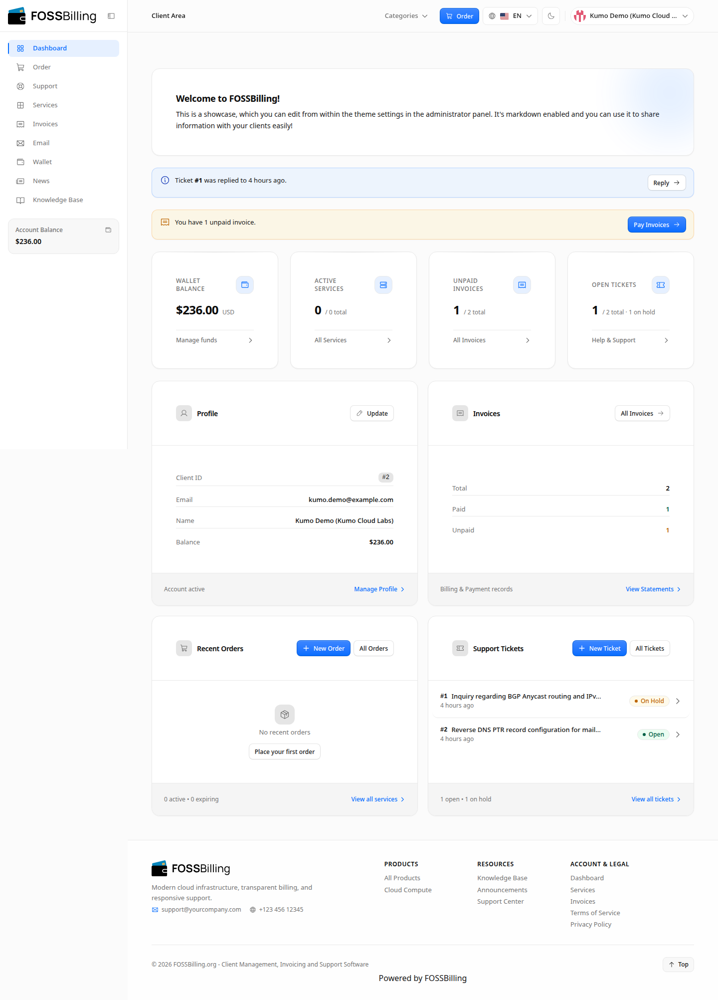
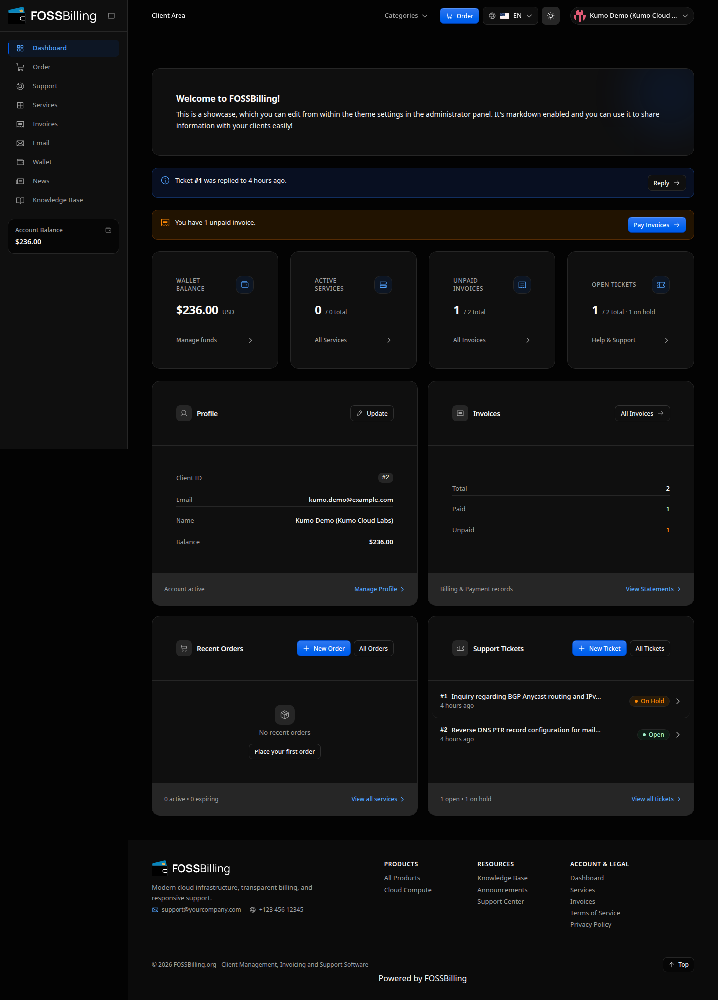
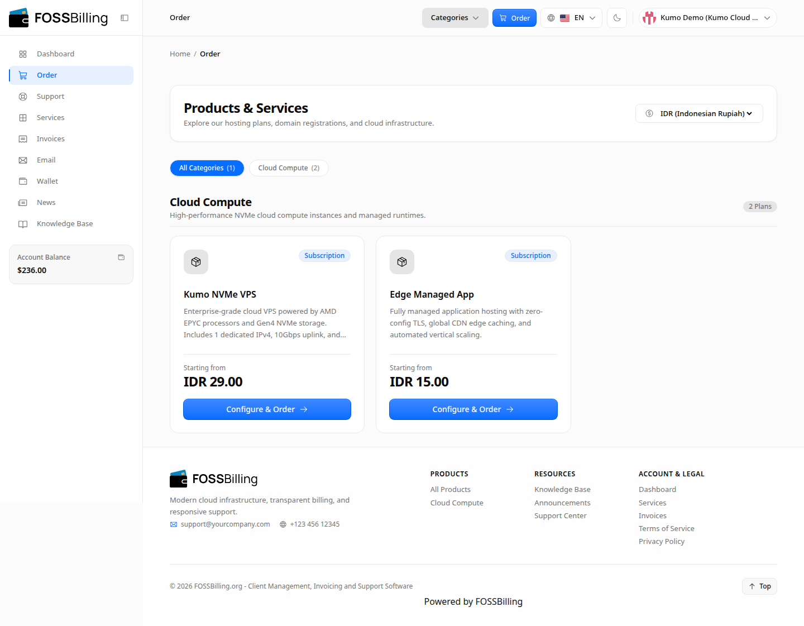
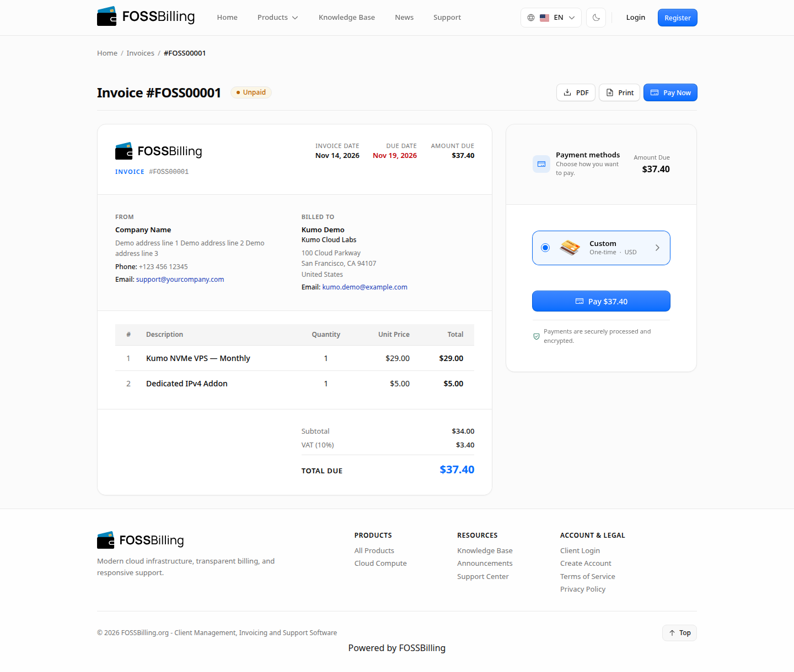

# Strata — FOSSBilling Client Theme

A clean, responsive client area theme for [FOSSBilling](https://fossbilling.org/), built with Twig, Tailwind CSS v4, TypeScript, and Bun.


## Screenshots

| Dashboard (Light) | Dashboard (Dark) |
| :---: | :---: |
|  |  |

| Product Catalog | Invoice & Checkout |
| :---: | :---: |
|  |  |

---

## Features

- **Light & Dark Mode** — Automatic persistence, admin default configuration, and quick navbar toggle.
- **Accent Color Presets** — Built-in `blue`, `orange`, `emerald`, and `violet` themes configurable from Theme Settings.
- **Zero jQuery / Bootstrap JS** — Vanilla TypeScript modules using native `<dialog>`, custom dropdowns, `Tom Select`, `intl-tel-input`, and `Motion`.
- **Print-Ready Invoices** — Direct browser `@media print` A4 formatting from `/invoice/{hash}` and `/invoice/print/{hash}`.
- **Full Client Area Coverage** — Dashboard, Product Catalog & Order Configurator, Service Management, Invoices, Support Tickets, Knowledge Base, News, Wallet, Profile, and Legal pages.
- **Bundled SVG Icon Sprite** — Tree-shaken Phosphor icon sprite built automatically from `client/icon-manifest.json`.

---

## Requirements

- [FOSSBilling](https://fossbilling.org/) (`0.8.9+` / `main`, PHP 8.3+)
- [Bun](https://bun.sh/) (`>= 1.0`) to build CSS, JS, and SVG icon assets

---

## Installation

> **Important (FOSSBilling Version Compatibility):**
> - **FOSSBilling `main` (Package Theme Structure):** Keep the `strata/client/` directory layout as-is inside `themes/strata/` (or `src/themes/strata/` in source checkouts).
> - **FOSSBilling `0.8.x` (e.g. `0.8.9`, Flat Theme Structure):** `0.8.x` expects `html/`, `assets/`, `config/`, and `manifest.json` directly under `themes/strata/` (like `themes/huraga/`), **not** nested inside `client/`. Extracting the repo directly as `themes/strata/` on `0.8.x` will cause a `#404 Page not found` error. Follow Option B below.

### Option A — FOSSBilling `main` (Package Layout)

1. Clone this repository into your FOSSBilling themes directory:

   ```bash
   git clone git@github.com:Khuirul-Huda/strata-theme.git src/themes/strata
   ```

2. Install dependencies and compile production assets:

   ```bash
   cd src/themes/strata/client
   bun install
   NODE_ENV=production bun run build
   ```

### Option B — FOSSBilling `0.8.x` / `0.8.9` (Flat Layout)

1. Clone or extract the repository, build inside `client/`, then move `client/` to `themes/strata`:

   ```bash
   cd /var/www/html/themes
   git clone https://github.com/Khuirul-Huda/strata-theme.git strata-tmp
   cd strata-tmp/client
   bun install
   NODE_ENV=production bun run build
   cd /var/www/html/themes
   mv strata-tmp/client strata
   rm -rf strata-tmp
   ```

2. Ensure web server file permissions match your setup (e.g. `chown -R www-data:www-data /var/www/html/themes/strata`).

### Activate Theme

- Open **Admin Panel → System → Settings → Theme** (or **Extensions → Themes**), and set **Strata (Client Area)** as the active client theme.

> **Note:** Compiled assets under `assets/build/` are excluded from Git. Always run `bun run build` after pulling updates or packaging the theme for distribution.

---

## Development

Run inside `src/themes/strata/client/`:

| Command | Description |
|---|---|
| `bun run dev` | Watch Twig, CSS, TypeScript, and icons and rebuild automatically |
| `bun run build` | Build CSS, JS bundles, SVG sprite, and flag assets |
| `bun run build:icons` | Regenerate `client/assets/build/symbol/icons-sprite.svg` only |
| `bun run check:types` | Run `tsc --noEmit` TypeScript verification |

Configurable theme options (mode, accent color, motion intensity, collapsible sidebar, menus, footer, and meta tags) are defined in [client/config/settings.html.twig](client/config/settings.html.twig).

---

## Credits

Built with open-source packages including:

- [Tailwind CSS](https://tailwindcss.com/)
- [@cloudflare/kumo](https://github.com/cloudflare/kumo) (color & semantic token foundations)
- [Phosphor Icons](https://phosphoricons.com/)
- [Motion](https://motion.dev/)
- [Tom Select](https://tom-select.js.org/), [intl-tel-input](https://intl-tel-input.com/), and [flag-icons](https://flagicons.lipis.dev/)

---

## License

Released under the [MIT License](LICENSE).
